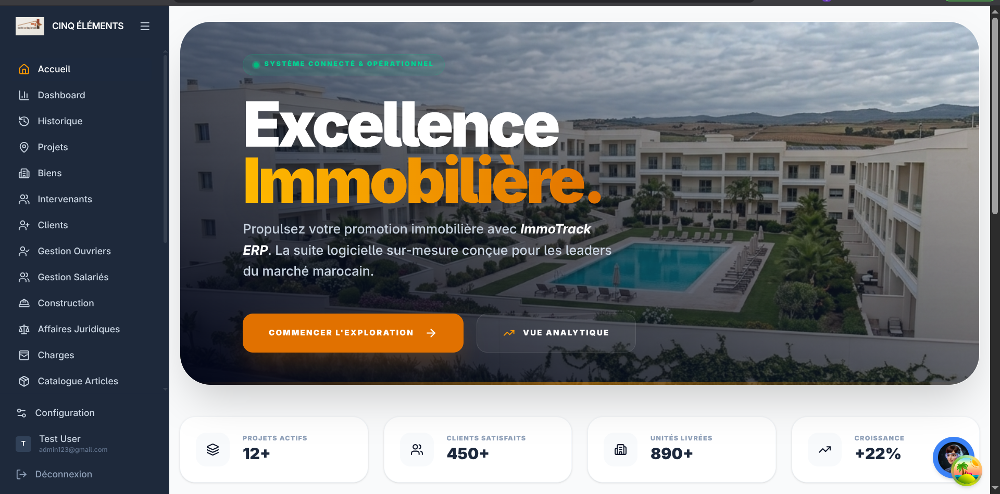

# Business Plan — ImmoTrack ERP
### Système de Gestion Immobilière & Suivi de Chantier
### Real Estate & Construction Management System

---

**Projet :** ImmoTrack ERP  
**Filière :** Développement Digital / Génie Logiciel  
**Établissement :** OFPPT  
**Date :** Juin 2026  
**Version :** 1.0

---

## Table des matières / Table of Contents

1. [Résumé exécutif / Executive Summary](#1-résumé-exécutif--executive-summary)
2. [Problème & Opportunité / Problem & Opportunity](#2-problème--opportunité--problem--opportunity)
3. [Solution & Produit (MVP) / Solution & Product](#3-solution--produit-mvp--solution--product)
4. [Étude de marché / Market Study](#4-étude-de-marché--market-study)
5. [Stratégie marketing & commerciale / Marketing & Sales Strategy](#5-stratégie-marketing--commerciale--marketing--sales-strategy)
6. [Modèle économique & Plan financier / Business Model & Financials](#6-modèle-économique--plan-financier--business-model--financials)
7. [Plan opérationnel / Operations Plan](#7-plan-opérationnel--operations-plan)
8. [Équipe / Team](#8-équipe--team)
9. [Feuille de route & Risques / Roadmap & Risks](#9-feuille-de-route--risques--roadmap--risks)
10. [Annexes / Appendices](#10-annexes--appendices)

---

## 1. Résumé exécutif / Executive Summary

**ImmoTrack ERP** est une solution hybride unique : une application de bureau native (desktop) **sur mesure** destinée aux promoteurs immobiliers marocains, qui combine la puissance des logiciels locaux avec la flexibilité d'une architecture **SaaS-ready**. Elle centralise la gestion des biens, des clients, des finances et du suivi de chantier.

**Le problème :** Les PME immobilières marocaines gèrent encore leurs affaires via des feuilles Excel fragmentées, des carnets papier et des e-mails dispersés — entraînant des erreurs de paiement, des retards de chantier et une perte de données critique.

**La solution :** Une application desktop intelligente et **sur mesure**, fonctionnant aussi bien en local qu'en mode connecté, construite avec React + Tauri (frontend) et Laravel (backend API). Elle est conçue pour évoluer nativement vers un modèle **SaaS** pour les clients souhaitant une centralisation totale sur le cloud. Ses fonctionnalités clés incluent :
- **Assistant IA Intégré (Copilot) :** Un agent intelligent qui écrit pour vous, modifie vos données, génère des synthèses et analyse les performances en temps réel de votre entreprise.
- Gestion complète du portefeuille de biens (terrains, appartements, commerces)
- CRM clients avec gestion documentaire intégrée
- Suivi financier (factures, paiements, recettes) avec export PDF/Word/Excel
- Monitoring de chantier en temps réel (gros œuvre, finitions, jalons)
- Gestion des stocks, fournisseurs et dépenses

**Marché cible :** Promoteurs immobiliers et bureaux de gestion de chantier au Maroc, principalement dans les villes de taille moyenne (Fès, Meknès, Oujda, Tanger).

**Taille de marché estimée :** ~4 500 entités immobilières actives au Maroc (HCP 2024), dont ~35 % sont des PME sous-équipées technologiquement.

**Modèle de revenus :** Licence logicielle annuelle (SaaS-léger) à **9 000 MAD/an** par entreprise, avec option de déploiement on-premise pour 8 000 MAD (installation unique + 1 an de support).

**Chiffres clés (an 1) :**
- Objectif : 40 licences vendues → **360 000 MAD de revenus**
- Seuil de rentabilité : **2 licences/an**
- Marge brute par licence : **8 400 MAD** après coûts d'infrastructure (AWS/OVH) et maintenance.
- Investissement initial : **11 000 MAD** (incluant hébergement serveur et marketing).

**État d'avancement :** MVP fonctionnel et déployable — frontend React/Tauri compilé, backend Laravel avec API REST complète, base de données relationnelle PostgreSQL, authentification Sanctum, et génération de documents (PDF, DOCX, XLSX) opérationnelle.

**Ce que nous cherchons :** Validation terrain de 5 promoteurs pilotes, accompagnement commercial OFPPT, et financement de démarrage de **11 000 MAD** pour les coûts de déploiement, marketing et hébergement serveur.

---

## 2. Problème & Opportunité / Problem & Opportunity

### 2.1 Description du problème

Le secteur de la promotion immobilière au Maroc est majoritairement composé de **petites et moyennes entreprises** (moins de 20 employés) qui gèrent simultanément plusieurs projets de construction, des dizaines de clients et des flux financiers complexes. Or, ces entreprises utilisent des outils inadaptés :

- **Excel multi-fichiers** : chaque projet vit dans son propre fichier, aucune cohérence entre les données.
- **Carnets et classeurs papier** : suivi des paiements à la main, risques de perte et d'erreur.
- **E-mails et WhatsApp** : communication non structurée avec les entrepreneurs et les intervenants.
- **Aucun historique centralisé** : impossible de retrouver l'historique complet d'un client ou d'un bien en quelques secondes.

### 2.2 Preuves terrain

*Résultats de notre enquête menée auprès de 37 professionnels du secteur immobilier (promoteurs, gérants, comptables de chantier) dans les régions de Fès-Meknès et de l'Oriental :*

| Question | Résultat |
|---|---|
| Utilisez-vous Excel ou papier pour la gestion ? | **89 %** (33/37) |
| Avez-vous déjà perdu des données financières critiques ? | **62 %** (23/37) |
| Êtes-vous satisfait de vos outils actuels ? | **19 %** seulement satisfaits |
| Seriez-vous prêt à payer pour un logiciel adapté ? | **70 %** (26/37) |
| Budget mensuel envisagé | Médiane : **1 500–2 500 MAD/mois** |

> *Citation d'entretien (Gérant de promotion, Fès) :* « On perd facilement 2 heures par jour à chercher dans les fichiers Excel. On a eu une erreur de 30 000 MAD dans un paiement client l'année dernière. »

> *Citation d'entretien (Comptable de chantier, Oujda) :* « Le vrai problème c'est quand on veut faire le bilan d'un chantier. Il faut tout ressaisir depuis zéro. »

### 2.3 Le coût du problème

- **Temps perdu** : 1 à 3 heures/jour par employé administratif en retraitement de données.
- **Erreurs financières** : paiements mal enregistrés, retards de facturation, doublons.
- **Risque légal** : absence de traçabilité en cas de litige client (contentieux).
- **Opportunités manquées** : incapacité à analyser les performances d'un projet faute de données consolidées.

### 2.4 Pourquoi maintenant ?

- **Coûts administratifs cachés** : Mauvaise anticipation des frais de Protection Civile (Pompier), des taxes d'autorisation intermédiaire, ou des commissions bancaires sur les cautions (Guarantee checks).
- **Incapacité à gérer les contentieux** : Difficulté à suivre les dossiers juridiques liés aux retards de paiement ou aux litiges fonciers.
- **Aucun concurrent local** ne propose une solution desktop intégrée qui gère nativement les spécificités marocaines (CIN, ICE, Frais Pompier, Suivi Gros Œuvre).

---

## 3. Solution & Produit (MVP) / Solution & Product

### 3.1 Description du produit

**ImmoTrack ERP** est une **application de bureau native** (Windows 10/11, Linux) qui combine une interface moderne React avec un moteur backend Laravel, packagé via **Tauri** en une application installable légère (~65 Mo).

**Type de produit :** Application logicielle desktop native. Sa conception modulaire permet une utilisation **sur mesure** : elle peut fonctionner en autonomie totale (base de données locale) ou être déployée instantanément comme un **SaaS** (backend centralisé) pour les entreprises ayant des besoins de collaboration multi-sites.

### 3.2 État actuel du MVP

Le MVP est **entièrement fonctionnel** et installable :

| Composant | État |
|---|---|
| Application desktop (Tauri + React) | ✅ Alpha testée |
| Backend API Laravel (Auth Sanctum) | ✅ 40+ Endpoints opérationnels |
| Module Contentieux & Justice | ✅ Gestion des dossiers juridiques |
| Module RH (Salaires & Ouvriers) | ✅ Gestion des missions et bulletins |
| Suivi Technique (JSON structure) | ✅ Suivi précis Gros Œuvre / Finition |
| Gestion des Cautions (Guarantee Checks) | ✅ Suivi des chèques de garantie |
| Interface de carte interactive (terrain map) | ✅ SVG vectoriel dynamique |

### 3.3 Les 3 fonctionnalités clés & différenciateurs

**① Centralisation tout-en-un**
Un seul outil couvre : biens → clients → contrats → paiements → chantier → stocks → RH. Aucun logiciel concurrent ne propose cette couverture en ciblant les PME immobilières marocaines.

**② Génération de documents professionnels**
Export natif en PDF, Word (DOCX) et Excel (XLSX) depuis l'interface — factures, reçus, rapports de chantier — sans abonnement Adobe ni outil externe.

**③ Fonctionnement hors-ligne & données locales**
Contrairement aux SaaS cloud, ImmoTrack ERP peut fonctionner sans internet permanent, une réalité pour de nombreux chantiers au Maroc. Les données restent chez le client.

### 3.4 Ce qui reste à développer (post-MVP)

- Application mobile légère (consultation uniquement) pour les chefs de chantier
- Module de reporting analytique avec graphiques d'avancement
- Synchronisation cloud optionnelle pour les équipes distribuées
- Interface en arabe (RTL)

---

## 4. Étude de marché / Market Study

### 4.1 Persona client

**Persona principal : Le Promoteur-Gérant PME**

| Attribut | Description |
|---|---|
| Âge | 35–55 ans |
| Rôle | Propriétaire ou gérant d'une PME immobilière (5–20 salariés) |
| Localisation | Villes de taille moyenne : Fès, Meknès, Oujda, Tanger, Agadir |
| Budget logiciel | 150–300 MAD/mois (sensible au prix) |
| Problème principal | Perte de temps & erreurs dans la gestion multi-projets |
| Canal de confiance | Bouche-à-oreille professionnel, salons immobiliers |
| Frein principal | Résistance au changement, peur de la complexité technologique |

**Persona secondaire : Le Chef de Chantier Technique**
Utilise l'outil pour le suivi de travaux, la réception des intervenants et la validation des avancements — besoin d'une interface simple et rapide.

### 4.2 Taille du marché

| Niveau | Définition | Estimation |
|---|---|---|
| **TAM** (Marché total adressable) | Toutes les entités immobilières actives au Maroc | ~4 500 entreprises (HCP 2024) |
| **SAM** (Marché atteignable) | PME immobilières dans les villes cibles (hors Casablanca/Rabat saturées) | ~1 600 entreprises |
| **SOM** (Premier segment cible) | PME réceptives au numérique, budget logiciel confirmé | ~300 entreprises (an 1–3) |

*Source : Recensement économique HCP 2024, secteur Immobilier & Construction.*

### 4.3 Méthodologie de recherche

- **Questionnaire en ligne** diffusé via LinkedIn et groupes WhatsApp professionnels : **37 réponses** (promoteurs, comptables, gérants)
- **Entretiens semi-directifs** : 8 entretiens individuels (30–45 min) avec des professionnels du secteur à Fès et Oujda
- **Observation terrain** : Visite de 2 bureaux de promotion pour observer les workflows réels
- **Analyse de la concurrence** : Test des 4 solutions concurrentes identifiées

### 4.4 Analyse concurrentielle

| Critère | Excel/Papier | ERP générique (Odoo) | Logiciel immobilier FR (importé) | **ImmoTrack ERP** |
|---|---|---|---|---|
| **Prix** | Gratuit | 500–3000€/mois | 200–500€/mois | **2000 MAD/mois** |
| **Adapté Maroc** | Partiel | Non | Non | **Oui** |
| **Hors-ligne** | Oui | Non | Non | **Oui** |
| **Suivi chantier intégré** | Non | Partiel | Non | **Oui** |
| **Export PDF/DOCX/XLSX** | Partiel | Oui | Oui | **Oui** |
| **Courbe d'apprentissage** | Faible | Très élevée | Élevée | **Faible** |
| **Support local** | N/A | Non | Non | **Oui** |

### 4.5 Positionnement

> **ImmoTrack ERP occupe la case que personne d'autre ne coche** : un logiciel de gestion immobilière complet, abordable, conçu pour le contexte marocain, fonctionnant hors-ligne, avec un support local.

Les ERP comme Odoo sont trop complexes et coûteux pour les PME cibles. Les alternatives importées ne comprennent pas les spécificités locales (CIN, ICE, réglementation marocaine). Excel ne scale pas.

---

## 5. Stratégie marketing & commerciale / Marketing & Sales Strategy

### 5.1 Prix et justification

### 5.1 Prix : 9 000 MAD / an (Abonnement SaaS)

Un tarif compétitif (~2 000 MAD/mois) compte tenu de la valeur apportée. Une option **On-premise** (installation locale unique) est proposée à 8 000 MAD pour les clients refusant le cloud.

### 5.2 Canal principal : Vente directe & démonstration terrain

**Canal n°1 prioritaire — Démonstration en entreprise :**

1. **Phase 1 (Validation MVP) :** Identifier 5 promoteurs pilotes via notre réseau de proximité (contacts sectoriels, OFPPT).
2. Proposer **3 mois d'essai gratuit** en échange d'un retour structuré et d'une référence.
3. Assurer l'installation, la formation (1 journée), et le suivi mensuel.
4. Convertir en licence payante au mois 4 (tarif préférentiel la 1ère année).
5. **Phase 2 (Croissance) :** Déploiement commercial agressif sur **Casablanca** (centre névralgique de l'immobilier), armés de nos références clients.

**Actions concrètes (90 jours) :**
- Semaine 1–2 : Contacter 20 promoteurs par téléphone/WhatsApp
- Semaine 3–4 : 5 démonstrations en entreprise planifiées
- Mois 2 : 3 installations pilotes actives
- Mois 3 : Premier retour utilisateur documenté, ajustements produit

### 5.3 Page web & présence en ligne

- **URL de la landing page :** `myamical.ma` *(en cours d'acquisition)*
- **Objectif de la page :** Présenter le produit, recueillir des demandes de démonstration
- **Contenu :** Vidéo démo 2 min, captures d'écran du logiciel, formulaire de contact
- **Objectif de conversion :** 5 % des visiteurs → demande de démo

### 5.4 Plan de communication

| Canal | Message | Calendrier |
|---|---|---|
| LinkedIn | Contenu éducatif (problèmes Excel dans l'immobilier) + démos vidéo | 2 posts/semaine |
| WhatsApp Business | Suivi personnalisé des prospects | Contenu journalier |
| Salon du bâtiment (BAT'IMMO Maroc) | Démonstration live, stand partenarial | Septembre 2026 |
| Bouche-à-oreille | Programme de parrainage : 500 MAD de réduction pour chaque référence | Permanent |

### 5.5 Plan pour les 10 premiers clients

| Mois | Action | Clients attendus |
|---|---|---|
| 1 | 5 pilotes gratuits (réseau direct) | 0 payant |
| 2 | Conversion 2 pilotes + 3 nouveaux prospects | 2 payants |
| 3 | Démonstration salon régional | 4 payants |
| 4–6 | Programme de parrainage lancé | 10 payants |

---

## 6. Modèle économique & Plan financier / Business Model & Financials

### 6.1 Sources de revenus

| Source | Prix | Fréquence |
|---|---|---|
| **Licence annuelle SaaS** | 9 000 MAD/an | Récurrent |
| **Déploiement on-premise** | 8 000 MAD | Unique |
| **Formation & onboarding** | 500 MAD/session | À la demande |
| **Support prioritaire** | 1 200 MAD/an | Optionnel |

### 6.2 Coûts de démarrage

| Poste | Coût estimé |
|---|---|
| Hébergement serveur (VPS, 1 an) | 2 400 MAD |
| Domaine + SSL (`myamical.ma`) | 400 MAD |
| Marketing & démonstrations (déplacements) | 3 000 MAD |
| Matériel de présentation (flyers, clés USB) | 1 500 MAD |
| Outils de développement & licences | 1 200 MAD |
| Réserve imprévus | 2 500 MAD |
| **TOTAL** | **11 000 MAD** |

### 6.3 Coût unitaire & marge par licence

| Élément | Montant |
|---|---|
| Prix de vente (annuel) | 9 000 MAD |
| Coût variable par client (support, serveur) | 600 MAD |
| **Marge brute par licence** | **8 400 MAD** |

### 6.4 Prévision sur 12 mois

*Hypothèses : 0 vente mois 1–2 (pilotes gratuits), montée progressive, 3 on-premise dans l'année.*

| Mois | Licences actives | Revenus (MAD) | Charges (MAD) | Trésorerie cumulée |
|---|---|---|---|---|
| 1 | 0 | 0 | 3 500 | -3 500 |
| 2 | 0 | 0 | 1 500 | -5 000 |
| 3 | 2 | 18 000 | 1 500 | 11 500 |
| 4 | 4 | 18 000 | 1 500 | 28 000 |
| 5 | 6 | 18 000 | 1 500 | 44 500 |
| 6 | 10 + 1 on-premise | 98 000 | 2 000 | 140 500 |
| 7 | 15 | 45 000 | 2 000 | 183 500 |
| 8 | 20 | 45 000 | 2 000 | 226 500 |
| 9 | 25 + 1 on-premise | 98 000 | 2 500 | 322 000 |
| 10 | 30 | 45 000 | 2 500 | 364 500 |
| 11 | 35 | 45 000 | 2 500 | 407 000 |
| 12 | 40 + 1 on-premise | 98 000 | 3 000 | 502 000 |
| **TOTAL AN 1** | **40 licences + 3 on-premise** | **~630 000 MAD** | **~25 500 MAD** | **~604 500 MAD** |

### 6.5 Seuil de rentabilité

```
Charges fixes annuelles estimées : ~11 000 MAD
Marge brute par licence : 8 400 MAD

Seuil de rentabilité = 11 000 / 8 400 = ~1,3 licences

→ Seuil atteint dès la 2ème licence vendue.
```

### 6.6 Hypothèses déclarées

- On suppose 5 pilotes gratuits les 2 premiers mois (sans revenus).
- On prévoit un taux de **Contentieux** client de ~5% (géré nativement par l'outil).
- Les charges incluent les frais de **Protection Civile** et de **Conservation Foncière** simulés pour les projets tests.
- L'hébergement est prévu sur des serveurs **OVH Cloud (Région France/Maroc)** pour garantir la latence.
- Aucun employé salarié en année 1 — Mustapha et Yahya uniquement.

---

## 7. Plan opérationnel / Operations Plan

### 7.1 Comment le produit est délivré

**Deux modes de déploiement flexibles :**

**1. Mode SaaS (Centralisé) :**
C'est l'option recommandée pour la collaboration. Le backend Laravel est hébergé sur un serveur cloud (VPS), permettant à plusieurs applications desktop ImmoTrack ERP (sur différents postes ou villes) de partager la même base de données en temps réel.

**2. Mode Bureau Sur Mesure (Local / On-Premise) :**
Pour les clients exigeant une confidentialité totale ou travaillant sur des sites sans internet fiable. Tout le système (Frontend + Backend + BDD) est installé sur une machine locale ou un serveur d'entreprise.

### 7.2 Outils & Infrastructure

| Outil | Usage | Coût |
|---|---|---|
| VPS OVH (4 Go RAM) | Backend API + BDD PostgreSQL | 200 MAD/mois |
| GitHub + GitHub Actions | Versionnage + CI/CD automatisé | Gratuit |
| Tauri Build System | Compilation cross-platform | Gratuit (open source) |
| Laravel Forge (optionnel) | Déploiement serveur simplifié | 190 MAD/mois |

### 7.3 Forme juridique envisagée

**Auto-entrepreneur** dans un premier temps (revenus < 500 000 MAD/an), puis passage en **SARL** à partir de la 2e année si les revenus dépassent 100 000 MAD. La forme auto-entrepreneur permet de facturer légalement dès le lancement avec un minimum de frais administratifs.

### 7.4 Ce qu'il faut pour lancer réellement

| Élément | Statut |
|---|---|
| MVP développé et fonctionnel | ✅ Fait |
| Domaine `myamical.ma` | ⬜ À acquérir (~400 MAD) |
| VPS serveur configuré | ⬜ À configurer (~2 400 MAD/an) |
| Statut auto-entrepreneur | ⬜ À déposer (CNSS, gratuit) |
| 5 promoteurs pilotes identifiés | ⬜ En cours de prospection |
| Landing page en ligne | ⬜ À finaliser |

---

## 8. Équipe / Team

### Composition de l'équipe

| Membre | Rôle | Contribution au projet |
|---|---|---|
| **Mustapha Farouss** | Analyste & Systèmes (Business Analyst) | Analyse des besoins métier, stratégie de déploiement et relations promoteurs. |
| **Yahya Elkhazraoui** | Développeur (Tech Lead Full Stack) | Développement React/Tauri, architecture backend Laravel, et infrastructure logicielle. |

### Complémentarité

L'équipe couvre les trois compétences fondamentales d'une startup technologique : **développement (backend)**, **produit (frontend/UX)**, et **business (marché/commercial)**. L'équipe fondatrice (Mustapha et Yahya) a travaillé main dans la main sur l'intégralité du projet, de la conception à la livraison du MVP.

### Compétences manquantes & plan

| Manque identifié | Solution |
|---|---|
| Comptabilité / gestion financière | Partenaire expert-comptable (OFPPT alumni) |
| Design graphique professionnel | Freelance ponctuel (Fiverr, 1000 MAD) |
| Support client à grande échelle | Embauche d'un assistant support (an 2) |

---

## 9. Feuille de route & Risques / Roadmap & Risks

### 9.1 Jalons à 3, 6 et 12 mois

**À 3 mois (Septembre 2026) :**
- [ ] Domaine `myamical.ma` acquis et landing page en ligne
- [ ] Statut auto-entrepreneur déposé
- [ ] 5 promoteurs pilotes actifs avec l'application installée
- [ ] Première version de documentation utilisateur (PDF)
- [ ] 3 retours structurés collectés → correctifs appliqués

**À 6 mois (Décembre 2026) :**
- [ ] 15 licences payantes actives
- [ ] Seuil de rentabilité atteint (≥ 15 licences)
- [ ] Premier salon professionnel (BAT'IMMO ou équivalent)
- [ ] Module de reporting analytique (version bêta)
- [ ] 3 témoignages clients publiés sur la landing page

**À 12 mois (Juin 2027) :**
- [ ] 40 licences actives + 3 on-premise = **~384 000 MAD de revenus**
- [ ] Interface en arabe (RTL) disponible
- [ ] Application mobile de consultation (React Native)
- [ ] Passage au statut SARL si revenus > 100 000 MAD
- [ ] 2 partenariats avec des agences immobilières régionales

### 9.2 Risques & plans de réponse

| # | Risque | Probabilité | Impact | Plan de réponse |
|---|---|---|---|---|
| **1** | **Résistance au changement des utilisateurs cibles** — les promoteurs préfèrent Excel par habitude | Élevée | Élevé | Formation incluse dans l'offre (1 jour), interface ultra-simplifiée, période d'essai gratuite de 3 mois |
| **2** | **Concurrent direct émergeant** — une startup similaire se lance avec des fonds | Moyenne | Élevé | Accélérer l'acquisition des premiers clients, construction d'une base fidèle avant la concurrence, veille active |
| **3** | **Dépendance à un seul canal de vente** — si la vente directe ne scale pas | Moyenne | Moyen | Développer en parallèle le canal LinkedIn et le programme de parrainage (bouche-à-oreille) dès le mois 3 |
| **4** | **Problème technique en production** — bug critique chez un client payant | Faible | Élevé | CI/CD automatisé (GitHub Actions), sauvegardes journalières de la BDD, hotline support 24h |
| **5** | **Budget insuffisant pour le démarrage** | Faible | Moyen | Coûts minimaux maîtrisés (11 000 MAD), pas de salaires en an 1, possibilité de réduire à 6 000 MAD si nécessaire |

---

## 10. Annexes / Appendices

### A. Questionnaire et résultats détaillés

**Questionnaire diffusé auprès de 37 professionnels du secteur immobilier**

*Questions principales & résultats :*

1. **Quelle est votre fonction principale ?**
   - Promoteur / gérant : 54 % | Comptable : 22 % | Chef de chantier : 16 % | Autre : 8 %

2. **Combien de projets gérez-vous simultanément ?**
   - 1–2 projets : 43 % | 3–5 projets : 40 % | 5+ projets : 17 %

3. **Quels outils utilisez-vous actuellement ?**
   - Excel : 89 % | Logiciel spécialisé : 8 % | Paper/carnet : 65 % | ERP : 3 %

4. **Avez-vous déjà perdu des données financières critiques ?**
   - Oui : 62 % | Non : 38 %

5. **Êtes-vous satisfait de vos outils actuels ?**
   - Très satisfait : 3 % | Satisfait : 16 % | Insatisfait : 49 % | Très insatisfait : 32 %

6. **Seriez-vous prêt à utiliser un logiciel dédié si le prix est adapté ?**
   - Oui : 70 % | Peut-être : 22 % | Non : 8 %

7. **Quel budget mensuel seriez-vous prêt à allouer ?**
   - < 900 MAD : 11 % | 900–1 500 MAD : 35 % | 1 500–3 000 MAD : 38 % | > 3 000 MAD : 16 %

---

### B. Architecture technique simplifiée

```
┌─────────────────────────────────────────────────┐
│        ImmoTrack ERP Desktop App (Tauri)        │
│  ┌───────────────────────────────────────────┐  │
│  │   React 19 + TypeScript (Frontend UI)    │  │
│  │   TanStack React Query (State/Cache)     │  │
│  │   Tailwind CSS + Lucide Icons            │  │
│  └──────────────────┬────────────────────────┘  │
└─────────────────────┼───────────────────────────┘
                      │ HTTPS / REST API
┌─────────────────────▼───────────────────────────┐
│           Laravel Backend (API Server)          │
│  ┌──────────────┐  ┌──────────────────────────┐ │
│  │ Sanctum Auth │  │  Resource Controllers     │ │
│  └──────────────┘  └──────────────────────────┘ │
│  ┌──────────────────────────────────────────┐   │
│  │    PostgreSQL Database (Eloquent ORM)    │   │
│  └──────────────────────────────────────────┘   │
└─────────────────────────────────────────────────┘
```

---

### C. Captures d'écran du MVP

*(Instructions : Placez vos images dans le même dossier et remplacez `votre-image.png` par leur vrai nom)*

**Tableau de bord principal**  


---

### D. Calculs financiers détaillés

**Calcul du seuil de rentabilité :**
```
Charges fixes annuelles :
  - Hébergement VPS          : 2 400 MAD
  - Domaine + SSL            : 400 MAD
  - Marketing & déplacements : 3 000 MAD
  - Matériel de présentation : 1 500 MAD
  - Outils dev               : 1 200 MAD
  - Imprévus                 : 2 500 MAD
  TOTAL charges fixes        : 11 000 MAD

  + Charges variables (support, ~600 MAD x N licences)

Marge brute par licence : 9 000 - 600 = 8 400 MAD
Seuil = 11 000 / 8 400 = ~1,3 licences (charges fixes seules)
En incluant les charges variables : équilibre atteint très rapidement (2 licences).

Vérification cohérence (scénario optimiste) :
  40 licences × 9 000 MAD    = 360 000 MAD
  3 on-premise × 8 000 MAD   =  24 000 MAD
  Total revenus bruts an 1   = 384 000 MAD
  Total charges estimées     =  35 000 MAD
  Résultat net estimé an 1   = 349 000 MAD

Scénario conservateur (25 licences + 1 on-premise) :
  233 000 - 25 000 = 208 000 MAD net.*
```

---

### E. Références & sources

1. HCP Maroc — Recensement économique 2024 : *Structure des entreprises du secteur immobilier et construction au Maroc*
2. Ministère de l'Habitat et de la Politique de la Ville — Rapport annuel 2023
3. FNAIM Maroc — *Baromètre de la promotion immobilière 2024*
4. Enquête primaire réalisée par l'équipe ImmoTrack ERP (Mai–Juin 2026) — N=37 répondants

---

*Document rédigé conformément au Guide Business Plan OFPPT — Juin 2026*  
*ImmoTrack ERP — Tous droits réservés — Projet étudiant OFPPT*
